# When will my bus come? — open bus arrival-time (ETA) estimation for Indian cities

This repository holds the arrival-time model behind the live bus maps at
[maps.reclaimchennai.city](https://maps.reclaimchennai.city): Chennai MTC, Delhi, Bengaluru BMTC, Mumbai, Gurugram,
Tricity (Chandigarh), APSRTC and TGSRTC. Everything is included so that anyone can check our numbers, run the model
and improve it:

- every script we tried, from the first baseline to the live service;
- the trained weights;
- the raw GPS archives and processed datasets (as a GitHub Release, about 10 GB compressed);
- the live-traffic scrapers;
- the evaluations, including what did **not** work.

<p align="center">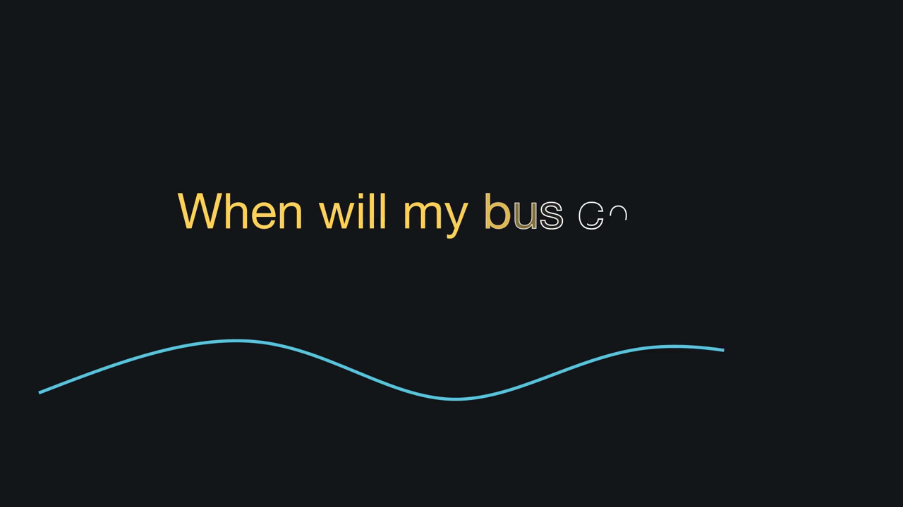 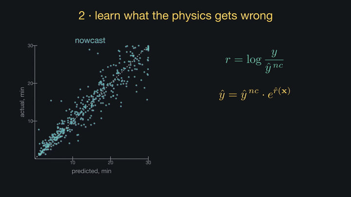</p>

**Watch the 2-minute explainer** ([`video/eta_v4_explainer.mp4`](video/eta_v4_explainer.mp4), 1080p, made with
[manim](https://www.manim.community/)). It shows the factors, the formulas and the sources; the script is
[`video/eta_explainer.py`](video/eta_explainer.py).

---

## Contents

1. [Results](#1-results)
2. [How the estimator works](#2-how-the-estimator-works)
3. [Checking it honestly](#3-checking-it-honestly)
4. [Live traffic alerts: do they help?](#4-live-traffic-alerts-do-they-help)
5. [What is in this repository](#5-what-is-in-this-repository)
6. [Data](#6-data)
7. [Reproduce](#7-reproduce)
8. [Running it live](#8-running-it-live)
9. [What did not work](#9-what-did-not-work)
10. [Limits, licence, citing](#10-limits-licence-citing)

---

## 1. Results

**Metric:** mean absolute error (MAE) of the predicted arrival time, in seconds, over every stop 1–30 minutes ahead of
every bus. The truth is when the bus actually crossed the stop, interpolated between its GPS fixes.

### 1.1 Held-out days, scored causally

The historical speed model is rebuilt from the 7 days *before* the scored day only (`src/audit_v4.py`; see
[§3](#3-checking-it-honestly) for why).

| City | Test day | Queries | Nowcast | **v4** | Change |
|---|---|---:|---:|---:|---:|
| Chennai MTC | 23 Nov 2026 | 1.17 M | 135.5 s | **92.3 s** | −32% |
| Chennai MTC | 24 Nov 2026 (fresh, never used before) | — | 130.0 s | **86.3 s** | −34% |
| Bengaluru BMTC | 23 Nov 2026 | 0.36 M | 147.3 s | **95.3 s** | −35% |
| Bengaluru BMTC | 24 Nov 2026 (fresh) | — | 128.8 s | **92.1 s** | −29% |
| Delhi (DTC + cluster) | 23 Nov 2026 | 1.50 M | 153.1 s | **98.8 s** | −35% |
| Mumbai (BEST, TMT, KDMT, VVMT) | 17 Nov 2026 | 83 k | 90.0 s | **84.9 s** | −6% |
| Gurugram | 17 Nov 2026 | 6 k | 277.7 s | **125.8 s** | −55% (small sample; no history model) |

The 80% range holds 78–82% of real arrivals on these days.

### 1.2 Live, against what the maps showed before

On 24 Nov 2026, 16:53–18:20 IST, all three were scored for the same bus, the same GPS fix and the same stop
(`serve/shadow_eval.py`):

| City | What the map showed | Nowcast | **v4** | Queries |
|---|---:|---:|---:|---:|
| Chennai MTC | 197.8 s (MTC's own ETAs) | 158.2 s | **103.8 s** | 105,804 |
| Bengaluru BMTC | 350.7 s (BMTC's own ETAs) | 93.9 s | **84.4 s** | 4,448 |
| Delhi | 198.9 s (our nowcast) | 189.8 s | **126.3 s** | 52,653 |

v4 runs about 30 s late (median signed error +26 to +34 s), and the 80% range covered 77–84% of arrivals.

### 1.3 State transport (RTC) systems, without retraining ([`serve/RTC_AUDIT.md`](serve/RTC_AUDIT.md))

The same model, trained only on the five city systems above, was then tested on other live feeds:

| System | Held-out day: nowcast → v4 | What the map showed → v4 | Verdict |
|---|---|---|---|
| Tricity (CTU) | 342 → **153** s | 299 → **122** s | live |
| APSRTC | 344 → **155** s (236 k queries) | timetable, median 975 → **98** s | live |
| TGSRTC | 184 → **122** s | 135 → **93** s; worse 20–30 min ahead (n = 74) | live, up to 20 min ahead |
| AMTS, UPSRTC | — | — | collecting; needs 7 days of history |
| OSRTC | 174 → 166 s; worse 20–30 min ahead | — | off |
| Kerala, Haryana, Rajasthan, GSRTC | — | — | the feeds are too sparse to score |

**v4r, retrained with the RTC systems** ([`src/train_v4_rtc.py`](src/train_v4_rtc.py), weights in
[`models/v4r_rtc/`](models/v4r_rtc/)). This is v4's recipe on the five city systems plus 18–22 Nov of Tricity, TGSRTC
and APSRTC, each with its own city index. On the held-out 24 Nov, in a live-engine replay:

| System | v4 | **v4r** |
|---|---:|---:|
| Tricity | 143 s | **121 s** |
| TGSRTC | 109 s | **93 s** |
| APSRTC | 155 s | **104 s** (20–30 min ahead: 308 → 158 s; bias −46 → −1 s) |

The five city systems moved by −5.9 to +1.4 s, so v4r serves only the RTC maps.

<p align="center">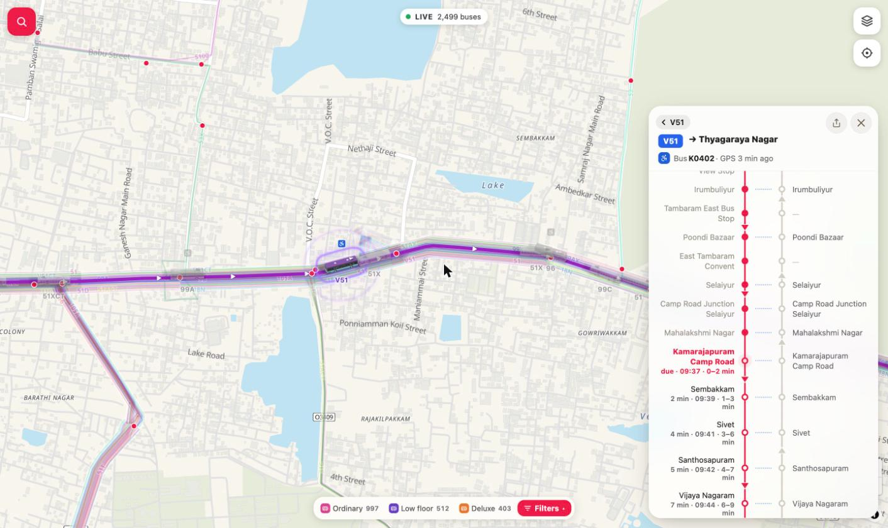<br>
<sub>A Chennai bus card on the live map: each upcoming stop shows the v4 time and its 80% range ("2 min · 09:39 · 1–3 min").</sub></p>

---

## 2. How the estimator works

<p align="center">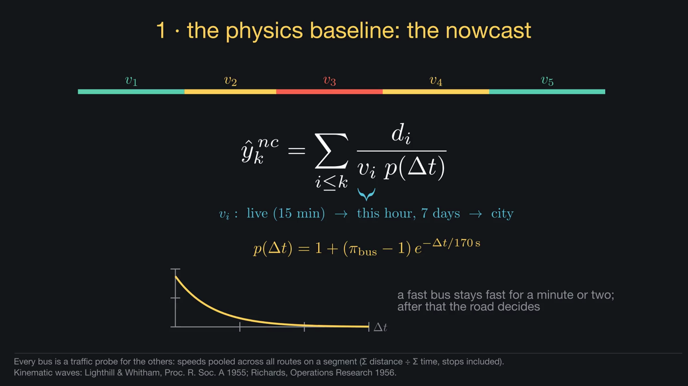 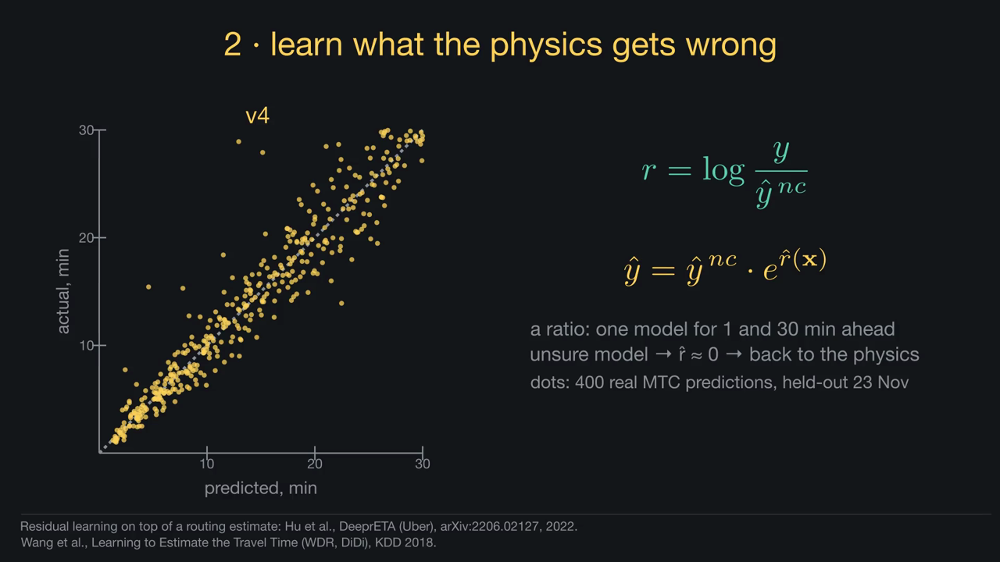</p>

### 2.1 Physics first: the nowcast

A route is cut into segments between stops. The time to reach stop *k* is the sum, over the segments ahead, of
distance divided by speed:

$$\hat y^{nc}_k=\sum_{i\le k}\frac{d_i}{v_i\,p(\Delta t)},\qquad p(\Delta t)=1+(\pi_{bus}-1)\,e^{-\Delta t/170\,\mathrm{s}}$$

- **Speed $v_i$.** Every bus is a traffic probe for the others: speeds are pooled across *all* routes that use the
  segment (total distance ÷ total time, stops included). The estimator prefers live probes from the last 15 minutes,
  falls back to the same hour over the last 7 days, then to the city-wide speed.
- **Pace $\pi_{bus}$.** This bus's own pace relative to the model. It fades within a couple of minutes, because after
  that the road decides, not the driver.
- **Code:** [`serve/nowcast.py`](serve/nowcast.py) and the reference implementations in [`reference/`](reference/).

### 2.2 Learn what the physics gets wrong

The model does not predict the arrival time directly. It predicts the log-ratio between the truth and the nowcast:

$$r=\log\frac{y}{\hat y^{nc}}\ (\text{clipped to }\pm1.5),\qquad \hat y=\hat y^{nc}\cdot e^{\hat r}$$

This one model serves both 1-minute and 30-minute horizons, and when it is unsure ($\hat r\approx 0$) it falls back
to the physics. This follows DeeprETA (Hu et al., 2022).

### 2.3 74 features, in six groups ([`src/train_v4_cached_ensemble.py`](src/train_v4_cached_ensemble.py))

| Group | What it measures |
|---|---|
| Baselines | the nowcast, the 7-day history, the live corridor estimate, the live ÷ history ratio |
| Live traffic | corridor speed over the last 5/15/30 min, its variability, stop-and-go, city-wide speed |
| This bus | pace vs the model, speed since its last fix, time and distance into the trip |
| Road ahead | distance, stops ahead, sinuosity, turning angles, OSM signals, flyovers, rail crossings ([`src/osm_infra_fetch.py`](src/osm_infra_fetch.py)) |
| When | time of day, weekday, holidays and festivals ([`data/holidays_india_2025_2026.json`](data/holidays_india_2025_2026.json)), rain over the last 1–24 h and heat ([`src/weather_fetch.py`](src/weather_fetch.py)) |
| Spacing | headway to the bus ahead, position on the route, route length |

<p align="center">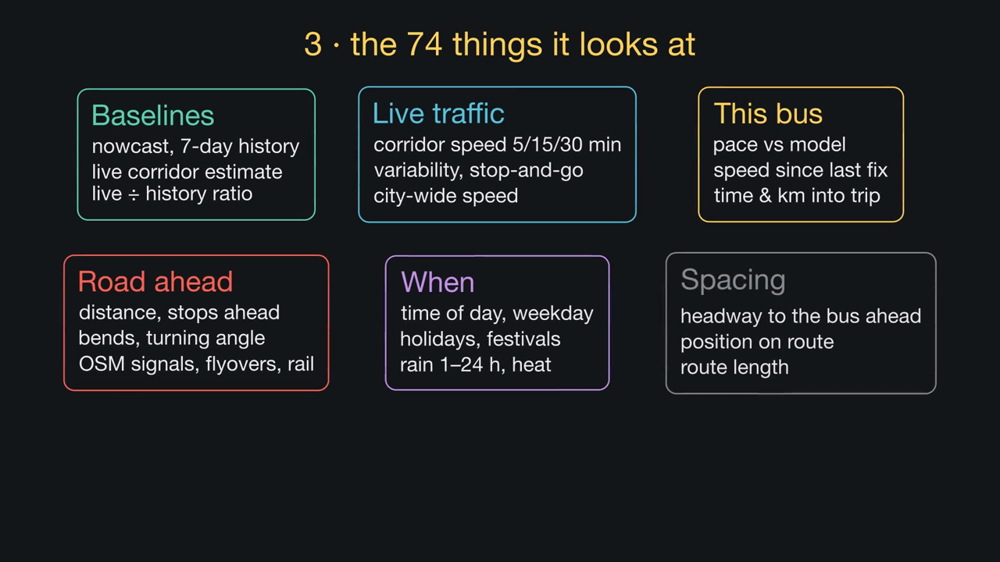</p>

### 2.4 Three gradient-boosted ensembles vote

$$\hat r = 0.40\,f_{\text{LightGBM}}(\mathbf x)+0.50\,f_{\text{XGBoost}}(\mathbf x)+0.10\,f_{\text{CatBoost}}(\mathbf x)$$

- **Losses.** LightGBM uses Huber loss, XGBoost Pseudo-Huber with δ = 0.25, and CatBoost MAE. These robust losses
  stop one strange trip (a breakdown, a detour) from dragging the rest.
- **Weights.** The blend weights were chosen on a validation day, never on the test day.
- **Trained weights:** [`models/v4_clean_ensemble/`](models/v4_clean_ensemble/), with their report in `v4_report.json`.

<p align="center">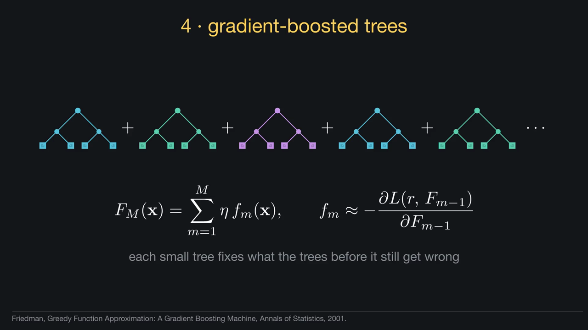 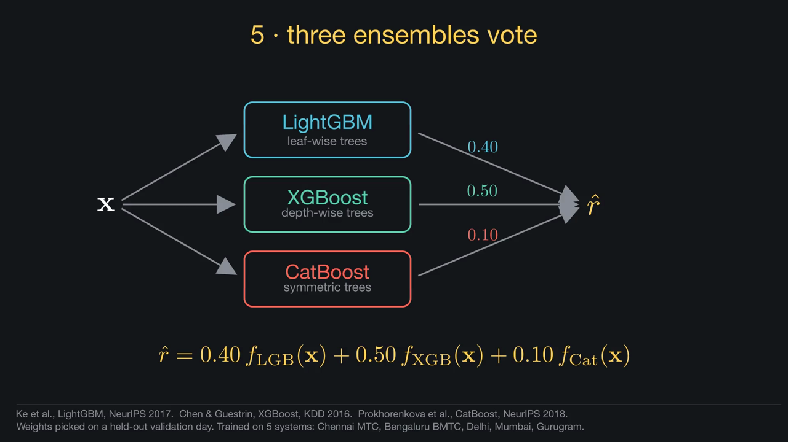</p>

### 2.5 An honest range that keeps itself calibrated

The 80% range comes from LightGBM quantile models (P10 and P90), widened by a conformal margin $m_b$ for each horizon
bucket *b*:

$$\big[\hat y^{nc}e^{q_{10}(\mathbf x)-m_b},\ \hat y^{nc}e^{q_{90}(\mathbf x)+m_b}\big]$$

Live, the margins adapt online with AgACI (Zaffran et al., 2022). Four experts with step sizes
$\gamma\in\{0.002,0.005,0.015,0.05\}$ each run

$$m_b^{(\gamma)}\leftarrow m_b^{(\gamma)}+\gamma\,(\mathbf 1[\text{arrival outside}]-0.20),$$

and the margin used is the median of the four. If too many buses arrive outside the range, it widens; if too few, it
narrows.

<p align="center">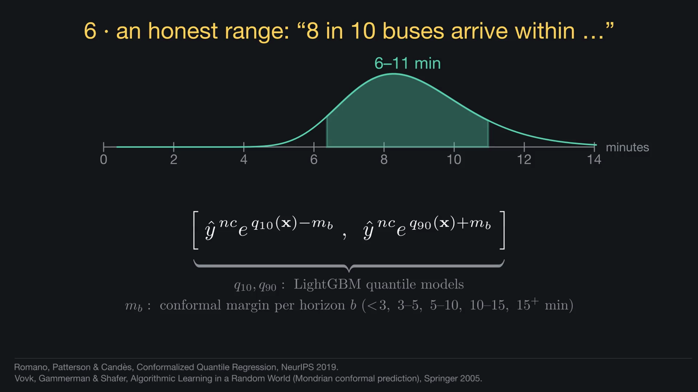 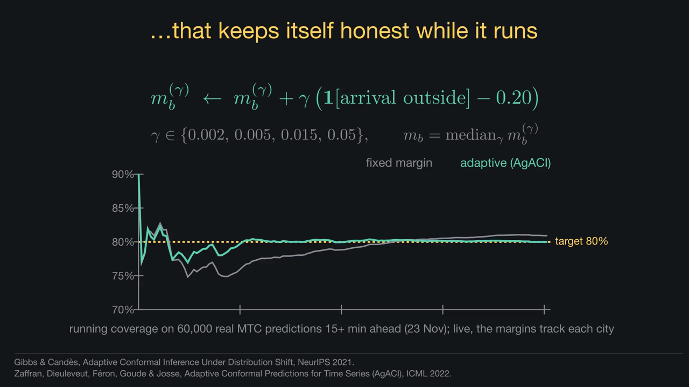</p>

### 2.6 How we got here

Each version lives in `src/` and was scored the same way:

| Version | Script | Idea |
|---|---|---|
| baseline | [`src/eval_eta.py`](src/eval_eta.py), [`reference/`](reference/) | the nowcast; a leak-free evaluator for horizons of 1–30 min |
| v1 | [`src/train_gbdt_cqr.py`](src/train_gbdt_cqr.py), [`src/train_dwell_model.py`](src/train_dwell_model.py) | one LightGBM with conformalised quantiles (CQR); a dwell-time hurdle model |
| v2 | [`src/train_v2_deepreta_cqr.py`](src/train_v2_deepreta_cqr.py) | the DeeprETA-style residual target; Mondrian CQR per horizon |
| v3 | [`src/train_v3_ensemble_agaci.py`](src/train_v3_ensemble_agaci.py) | the LGB+XGB+CatBoost stack, route geometry, online AgACI |
| v4r | [`src/train_v4_rtc.py`](src/train_v4_rtc.py) | v4 retrained with Tricity, TGSRTC and APSRTC; serves the RTC maps |
| **v4** | [`src/train_v4_cached_ensemble.py`](src/train_v4_cached_ensemble.py) | v3 with leaky columns removed, OSM infrastructure, holidays; cached features |
| tried | [`src/mask_cnn_baseline.py`](src/mask_cnn_baseline.py), [`src/colab_a100_train_v3.py`](src/colab_a100_train_v3.py), [`notebooks/`](notebooks/), [`src/llm_disruption_sidecar.py`](src/llm_disruption_sidecar.py) | a Mask-CNN paper reproduction (worse, §9); a deep residual net for a Colab A100 and an LLM that reads disruption text, both written but never benchmarked |

---

## 3. Checking it honestly

<p align="center">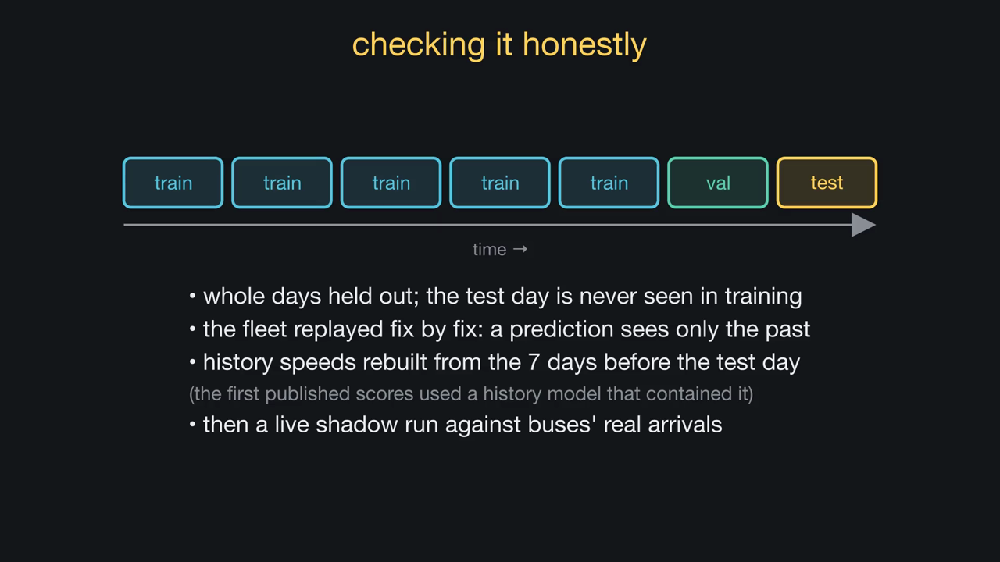</p>

- **Whole days are held out.** The test day is never seen in training. Validation is the day before it.
- **The fleet is replayed fix by fix, in the collector's own write order.** A prediction sees only what had arrived
  by then. Replaying in write order and in time order gives the same MAE (92.9 vs 92.9 s on MTC, 23 Nov), so the
  live engine and training agree.
- **A leak we found and fixed.** The first published scores used a historical speed model built *after* the test day,
  so it already contained it. `src/audit_v4.py` rebuilds that model from the 7 days before the scored day
  (`travel_model.py --until day-1`). The tables in §1 are the corrected, causal numbers, which is why they differ
  from the first write-up in [`docs/BENCHMARK_RESULTS.md`](docs/BENCHMARK_RESULTS.md). Mumbai's large gain mostly
  disappeared: its first history model had about one day of data.
- **Every stop ahead is scored.** Scoring only the stops the nowcast puts under 30 minutes, and extrapolating the
  rest, made the live engine 109 s instead of 93 s. Training keeps every stop whose *true* arrival is under 30
  minutes, so serving must score them all.
- **Not separated: vehicles.** About 99% of a test day's buses also ran on training days. There is no vehicle-id
  feature, and the same fleet runs tomorrow, so this matters little, but it is a limit.
- **Live shadow runs.** Before switching the maps over, v4 ran beside them and was scored against the arrivals seen
  afterwards ([`serve/shadow_eval.py`](serve/shadow_eval.py), [`serve/rtc_shadow_eval.py`](serve/rtc_shadow_eval.py)).

---

## 4. Live traffic alerts: do they help?

Traffic police in Hyderabad, Cyberabad, Delhi, Bengaluru and Chennai post closures, diversions, VIP movements,
waterlogging and breakdowns. We collect them all ([`traffic/`](traffic/), [`docs/TRAFFIC_SOURCES.md`](docs/TRAFFIC_SOURCES.md)),
including how we built the historical archives of tweets. We then tested three ways of using them:

1. **As features in a retrain:** an incident ahead, its type, distance to it, and minutes since it started.
2. **As a post-hoc penalty** on the buses whose remaining path crosses an active incident
   ([`serve/incident_penalty.py`](serve/incident_penalty.py)).
3. **Doing nothing,** on the view that the GPS fixes of buses already on that road reveal the slowdown.

**What we found** (details, numbers and code: [`docs/TRAFFIC_INTEGRATION.md`](docs/TRAFFIC_INTEGRATION.md),
[`traffic_eval/`](traffic_eval/)):

**Verdict: not helpful as an ETA input today. The buses' own GPS already carries the information.** We measured 88
incidents that crossed a scored bus path in Hyderabad (TGSRTC, 3.7 M predictions) and 11 in Delhi (32 M predictions),
all on days the model never trained on. Figures are per incident, with 95% bootstrap confidence intervals.

| Question | Hyderabad | Delhi |
|---|---|---|
| How much slower are buses at an alerted spot (same spot and time on other days = 1.00)? | 0.90, and already 0.91 **30–60 min before** the alert | 0.93 |
| Excess lateness of v4 through the alert: hour before / during / hour after | +53 / +66 / +44 s, the same in all three windows | +15 / −19 / +23 s |
| (b) The live `incident_penalty.py`, with uncalibrated priors | **+36 s worse** (+7 to +64) | **+294 s worse** (+170 to +438) |
| (b) A per-type delay calibrated leave-one-day-out | −15.5 s on alerted predictions, −0.4 s overall | about 0 |
| (a) Incident features in a residual model, beyond the same model without them | −2.0 s (−6.4 to +2.4) | −2.9 s (−4.9 to −0.9) |

<p align="center">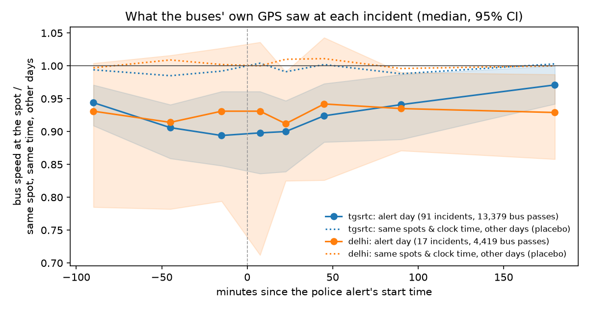 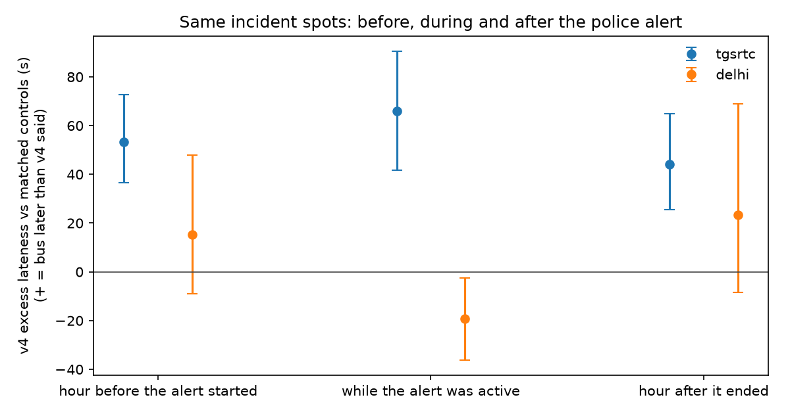</p>

- **The fleet sees the slowdown first.** It shows in the GPS before the alert's start time, so the alert brings little
  news.
- **v4's lateness doesn't come from the alert.** v4 is late in Hyderabad just as much before and after an alert as
  during it. That lateness is a general bias on a system it was never trained on, and retraining with the RTC
  systems fixes it: TGSRTC 109 → 93 s on an unseen day.
- **Calibrating needs far more events.** The per-incident effect varies with a standard deviation of about 112 s, so
  a per-type delay needs about 54 incidents *of that type* for ±30 s.
- **Bengaluru and Chennai can't be measured yet:** only 1 and 3 geolocated alerts overlap the GPS archive.

**Recommendation:** keep the alerts on the maps as information for riders, but leave them out of the ETAs. Spend the
effort on the GPS side instead. Re-run [`traffic_eval/run_all.sh`](traffic_eval/run_all.sh) when a city has 50 or
more alerts of a type.

**A related negative result.** Bengaluru Traffic Police's congestion dashboard gives a per-stop congestion profile by
hour of week. Adding it as features made v4 no better on BMTC: 93.0 → 93.1 s, with a paired difference of +0.13 s
(95% CI +0.08 to +0.18). A row-shuffled control showed the same. See
[`docs/BENCHMARK_RESULTS.md`](docs/BENCHMARK_RESULTS.md) §5 and [`src/train_v4_btp_ab.py`](src/train_v4_btp_ab.py).

---

## 5. What is in this repository

```
src/            training and evaluation: baseline → v1 → v2 → v3 → v4, the causal audit, feature fetchers
serve/          the live service: streaming engine, collector merge, replay/shadow evaluators, RTC adapters, deploy kit
models/         trained weights for every version (v4_clean_ensemble is live), with reports
reference/      the original nowcast / travel_model / backtest scripts the maps ran before v4 (Delhi, Mumbai)
traffic/        scrapers for traffic-police alerts and advisories (X via Sorsa/Nitter, WhatsApp channel, e-challan
                site, BTP dashboard, Delhi Traffic Police) and the geocoding pipeline
traffic_eval/   the evaluation of traffic alerts against GPS (section 4)
video/          the manim explainer: script, data prep, rendered mp4
docs/           benchmark write-ups, research notes and references (REFERENCES.bib), traffic docs, images
data/           small data in git (holidays, OSM infrastructure, weather, U-turns, traffic events);
                large data in the release (MANIFEST.json)
scripts/        pack_release.py and fetch_data.sh for the data release
notebooks/      the Colab A100 deep-model notebook
```

The four lines of work were developed on separate branches and merged into `main`:
`feat/baseline-eval` (the evaluator), `feat/features-and-data` (dataset extraction, OSM, weather, U-turns),
`feat/ml-models` (models v1–v4, the live service, RTC adapters, the incident penalty) and the original `main`
(docs, video). The branches are kept as they were.

---

## 6. Data

| Folder | What | Days | Size |
|---|---|---|---|
| `data/raw/<city>/obs-YYYY-MM-DD.jsonl[.gz]` | every GPS fix the live collectors saw: `{"t": epoch, "reg": bus, "r": route/working, "la", "lo", "k": next-stop index, "f": flags}` | MTC 19 Oct–24 Nov 2026; Delhi 10–24 Nov; BMTC 17–24 Nov; Mumbai 3–19 Nov; Gurugram 13–18 Nov; APSRTC, TGSRTC, Tricity, OSRTC, AMTS, Kerala 16–25 Nov; Haryana sparse since Nov 2024 | 12 GB raw |
| `data/rtc_src/<system>/` | the RTC networks (services, stop chains, segments) the adapters built from each map's feed | snapshot | 2.7 GB |
| `data/processed/` | stop-arrival and segment-traversal tables (parquet) extracted from the raw fixes | — | 2.3 GB |
| `data/v3_cache/` | the 74-feature query matrices per city-day (npz), the exact inputs of the v4 training | — | 3.0 GB |
| `data/meta/<city>/` | route stops, stop distances, the historical speed models (`model.json`) | — | 0.3 GB |
| `data/audit/`, `data/shadow*/` | causal audit outputs, live shadow logs | — | 0.8 GB |
| `data/traffic/` (in git) | official traffic-police posts and the geocoded events from them | 2020–2026 | small |
| `data/osm`, `data/weather`, `data/uturns`, holidays (in git) | road infrastructure, hourly weather, detected U-turns | — | small |

**Getting the large data:**

```bash
scripts/fetch_data.sh                    # everything (about 10 GB download), sha256-checked
scripts/fetch_data.sh raw-mtc audit      # or just some assets (names in data/MANIFEST.json)
```

**Where it comes from:** the GPS comes from the operators' public passenger feeds, polled by our collectors every
10 s to 3 min. It holds bus registration numbers, route ids and positions only; there is no personal data. Weather
comes from Open-Meteo and from a network of Chennai stations
([pol.reclaimchennai.city](https://pol.reclaimchennai.city)). Road infrastructure comes from OpenStreetMap
(© OpenStreetMap contributors, ODbL).

---

## 7. Reproduce

```bash
uv venv -p 3.12 .venv && uv pip install -p .venv/bin/python -r requirements.txt     # xgboost 3.4.1 needs Python >= 3.12
scripts/fetch_data.sh raw-mtc meta audit v3_cache
```

1. **The causal audit of one day:** rebuild history from the 7 days before, then score nowcast and v4.

```bash
.venv/bin/python src/audit_v4.py mtc 2026-11-23
```

2. **Replay the live engine over an archived day:** checks that it matches training.

```bash
.venv/bin/python serve/replay_eval.py mtc 2026-11-23 --model-json data/audit/model_mtc_until_2026-11-22.json
```

3. **Retrain v4 from the cached features:** this takes a few hours on 8 cores and writes `models/v4_clean_ensemble/`.

```bash
.venv/bin/python src/train_v4_cached_ensemble.py
```

4. **Re-score an RTC system:**

```bash
.venv/bin/python serve/rtc_audit.py tricity 2026-11-23
```

---

## 8. Running it live

[`serve/README.md`](serve/README.md) has the details.

- **One process scores every city.** `eta_ml_service.py` loads the models once, tails each collector's archive and
  writes `{bus: [route, fix, [stop, eta, lo, hi, ...]]}` every 10 s. It uses about 1.3 GB of RAM for the five city
  systems; Delhi has about 5,000 buses.
- **The collectors merge v4 times into their own feed.** They call `eta_ml_merge.py` just before writing
  `vehicles.json`, so the map cards and GTFS-RT `trip_updates` carry v4 times with no change of their own. The 80%
  ranges go to a sidecar file, `eta_range.json`.
- **If the service stops, the collectors fall back** to their own times within 2 minutes.
- **The RTC systems** (`rtc_feed.py`, `rtc_adapt.py`) feed a second instance from each map's public
  `vehicles.json`.
- **Traffic alerts:** `incident_penalty.py` can add a delay for incidents ahead. It runs on TGSRTC with uncalibrated
  priors; see §4 before relying on it.

The deploy scripts in `serve/deploy/` take hosts from environment variables (`RAWH`, `SVRH`, `PROJECTS`).

---

## 9. What did not work

| Tried | Result |
|---|---|
| BTP congestion profile as features (BMTC) | no gain; the shuffled control did the same (§4) |
| Scaling the nowcast beyond 30 min instead of scoring every stop | live MAE 109 s vs 93 s |
| v4 on OSRTC | +4.6% overall and worse 20–30 min ahead: the feed is too sparse |
| Kerala, Haryana, Rajasthan, GSRTC feeds | about one fix every 40 min, or stops about 60 km apart: nothing to learn from |
| Mask-CNN (Charul & Biyani 2019), reproduced | segment MAE 19.8 s vs 7.6 s for our v1 LightGBM on BMTC; 45.8 vs 13.5 s on Mumbai |
| Deep residual net on a Colab A100, LLM disruption sidecar | written (`src/colab_a100_train_v3.py`, `src/llm_disruption_sidecar.py`) but **not benchmarked**: open for anyone to try |
| Mumbai's published −31% | mostly a leak: −6% once its history model used 7 real days |

---

## 10. Limits, licence, citing

- **Limits.** These are a few weeks of data from November 2026. The 80% range is calibrated on average, not for
  every route. v4 runs about 30 s late live. Vehicles appear in both training and test days. Traffic alerts are few.
- **Licence.**
  - **Code:** MIT ([`LICENSE`](LICENSE)).
  - **Model weights and our derived data:** CC BY 4.0.
  - **Raw feeds:** the GPS and the traffic-police posts belong to their publishers. They are shared here for research
    and verification; check the publishers' terms before reusing them.
- **Papers and sources.** These are in [`docs/REFERENCES.bib`](docs/REFERENCES.bib) and in the video's footers:
  - Hu et al., *DeeprETA* (2022)
  - Ke et al., *LightGBM* (NeurIPS 2017)
  - Chen & Guestrin, *XGBoost* (KDD 2016)
  - Prokhorenkova et al., *CatBoost* (NeurIPS 2018)
  - Friedman, *Greedy function approximation* (Ann. Stat. 2001)
  - Romano et al., *Conformalized quantile regression* (NeurIPS 2019)
  - Gibbs & Candès, *Adaptive conformal inference* (NeurIPS 2021)
  - Zaffran et al., *AgACI* (ICML 2022)
  - Lighthill & Whitham (1955) and Richards (1956) on kinematic waves
  - Vovk et al., *Algorithmic Learning in a Random World* (2005)

Made by [Reclaim Chennai](https://reclaimchennai.city). Issues and pull requests are welcome, especially new cities,
better features and evaluations that prove us wrong.
