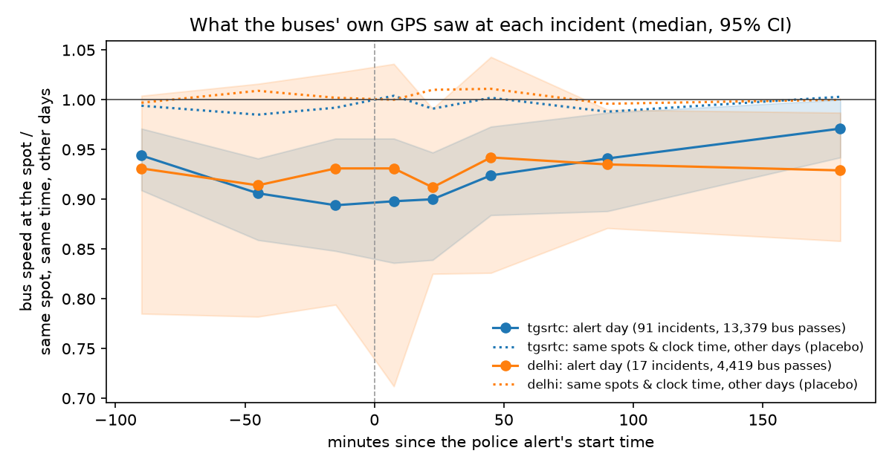
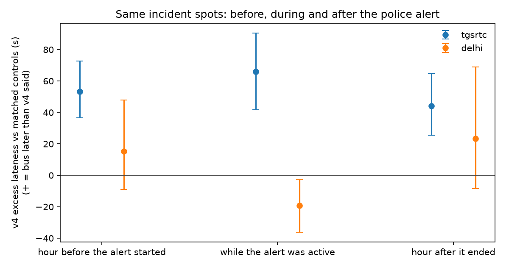
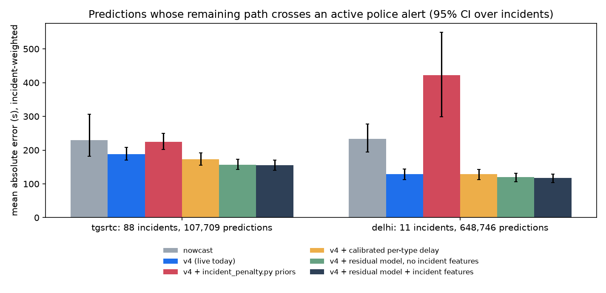

# Do police traffic alerts improve bus ETAs beyond the buses' own GPS?

*Evaluation run 26 Nov 2026. Code: [`traffic_eval/`](../traffic_eval/). Numbers: [`traffic_eval/results/summary.json`](../traffic_eval/results/summary.json).*

## Verdict

**Not helpful as an ETA input today; the buses' own GPS carries the information.** Measured on 88 incidents that
crossed a scored bus path in Hyderabad (TGSRTC, 3.7M predictions, 107,709 of them through an active alert) and 11 in
Delhi (32M predictions, 648,746 through an alert), all on days the model never trained on:

1. **The alerts are real but mild, and late.** At alerted spots buses run about 10% (Hyderabad) and 7% (Delhi) slower
   than at the same spot and time on other days. In Hyderabad the slowdown is already there **30–60 minutes before**
   the alert's start time. The fleet's GPS sees it first.
2. **Where v4 errs, it errs equally before the alert, during it and after it.** Hyderabad: v4 is late by +53 s in the
   hour before, +66 s during and +44 s after (overlapping CIs). Delhi: no lateness at all (−19 s). The alert adds no
   news v4 could use.
3. **The live incident penalty (`serve/incident_penalty.py`, uncalibrated priors) makes ETAs worse:** +36 s MAE per
   incident in Hyderabad (CI +7 to +64), +294 s in Delhi (CI +170 to +438), and much worse on the few Bengaluru and Chennai cases.
4. **Calibrating helps little.** A per-type delay calibrated leave-one-day-out cuts 15 s on Hyderabad's alerted
   predictions (−0.4 s across all predictions) and nothing in Delhi. Incident features in a residual model add 2–3 s
   (Delhi significant, Hyderabad not) over the same model without them. The same model without them gains far more
   (Hyderabad −32 s on alerted paths, −7 s on everything) by correcting v4's general bias on a system it never trained on.
5. **Bengaluru and Chennai cannot be measured yet:** 1 and 3 geolocated alerts overlap the GPS archive.

**What to do:** keep the alerts on the maps as information for riders, but take `incident_penalty.py` out of the ETAs
(or set its priors to the calibrated table in §4). Spend the effort on the GPS side instead: retrain v4 with TGSRTC (and
the other RTC systems) in the training set, and let it trust a live slowdown that has lasted 15+ minutes. Re-run this
evaluation when Hyderabad has 50+ alerts per type in the archive (about 1–2 months).

## 1. The question

Police departments publish breakdowns, accidents, waterlogging, diversions, closures, VIP movements and processions
on X, WhatsApp and their own websites. We collect four such feeds (sources and scrapers: `docs/TRAFFIC_SOURCES.md`):

| City | Feed | Bus system it is tested on |
|---|---|---|
| Hyderabad | @HYDTP, @CYBTRAFFIC, the HTP e-challan alert, the Cyberabad WhatsApp channel (twtrx) | TGSRTC, GPS from 17 Nov 2026 |
| Delhi | Delhi Traffic Police site + @dtptraffic (`delhi_bus/server/dtp_closures.py`) | DTC + cluster buses, GPS from 10 Nov |
| Bengaluru | @blrcitytraffic and the BTP division accounts (twtrx) | BMTC, GPS from 17 Nov |
| Chennai | @ChennaiTraffic road updates (twtrx) | MTC, GPS from 19 Oct |

v4 (the live model) already sees traffic through the buses themselves: per-segment speeds of every bus in the last
5/15/30 minutes, on the exact segment and on the shared road corridor, the bus's own pace, and the usual speed for that
segment and hour. So the question is not "does an accident slow buses?" (it does) but: **is there anything in an alert
that the fleet's GPS has not already told v4, early enough to matter?**

## 2. Method

### 2.1 Event normalisation (`traffic_eval/events.py`)

Each post becomes one event:

| Field | Rule |
|---|---|
| type | the pipeline's classifier (accident, breakdown, closure, congestion, diversion, event, fire, spillage, tree_fall, waterlogging, works, other); Delhi items typed by keywords |
| severity | 0–1 from the pipeline (e.g. closure 0.9, diversion 0.8, accident 0.65, breakdown 0.5, other 0.3) |
| window | the post's stated start and end; otherwise start = post time, end = start + the type's default (breakdown 45 min, accident 60, waterlogging 180, diversion/closure 240, works 480 …). Delhi's site defaults (6 h for an alert, 24 h for an advisory) are replaced by the type default when the post gives no hours |
| geometry | the road line the pipeline routed (OSRM between the named places, never a straight line) when it has one, else the geocoded point |
| dropped | "standing" advisories (one-way systems, months-long works: part of every day's speeds), U-turn changes, and events with no time or no geometry |

### 2.2 Matching an event to a prediction

A *query* is one prediction: bus *b* at fix time *t*, at metres *s* along its route, for stop *k* at metres *d_k*,
with the true time to arrival *y* (60 s ≤ *y* < 30 min). An incident *j* is **on the path** of the query when, at time *t*:

* it is active: `t_start(j) ≤ t < t_end(j)`;
* its point lies within 150 m (60 m for a road line) of one of the route's stop-to-stop chords between the bus and stop *k*:
  for chord *a→b* and point *p*, the distance is |*p* − (*a* + *f*(*b* − *a*))| with *f* = clamp(((*p*−*a*)·(*b*−*a*))/|*b*−*a*|², 0, 1)
  in a local metric plane;
* the pass point `at = d_i + f (d_{i+1} − d_i)` is more than 100 m ahead of the bus (`s + 100 < at ≤ d_k`) and at most 25 km ahead.

This is exactly the geometry of `serve/incident_penalty.py` (the module now live on the TGSRTC map); the evaluation imports
it, and a spot check of 300 queries gave identical delays.

### 2.3 The three ways to use an alert

**(a) Features for a retrain.** Per query: has-incident-ahead, type, severity, metres to the incident, minutes since it
started. Calibration = the model's own training. Here it is tested as a residual LightGBM on top of v4
(target log(*y*/*p̂*)), trained leave-one-day-out on the treated queries plus 4× as many others, **against the same model
without the five incident features**. That ablation matters: TGSRTC was never in v4's training set, so any residual
model fixes some of v4's general bias there, which is not the incidents' doing.

**(b) A post-hoc additive delay** (`serve/incident_penalty.py`): every stop beyond the incident gets

    delay = BASE[type] × (0.5 + severity),  ≤ 900 s per incident, ≤ 1500 s per bus,
    eased to 30% over the last 40% of the window

with BASE priors (breakdown 240 s, accident 300 s, closure 600 s, diversion 360 s, …) that were never calibrated.
Calibrated variant tested here: delay per type = the median *excess lateness* (below) of that type on the **other**
days (leave-one-day-out), added only where positive.

**(c) Nothing: rely on the GPS.** v4's live features (segment and corridor speeds, pace) should register a jam as soon as
buses drive through it. Tested directly by an event study of bus speeds at each incident (§2.5).

### 2.4 Scoring: difference-in-differences against matched controls

v4 has route-, stop- and hour-specific biases of its own, so comparing incident queries with all queries would mix
those in. For each treated query (incident on the path), the control is the mean lateness of **untreated queries on the
same route, to the same stop, in the same IST hour**, on any evaluated day (fallbacks: route × hour, then hour ×
horizon band; queries with an incident within 1 km but not on the path are excluded from the controls):

    lateness  L = y − ŷ                       (+ = the bus came later than predicted)
    excess    X = L_treated − mean(L_control in the same cell)

If alerts carry news v4 lacks, X is clearly positive during the alert, larger than at the same spots in the hour
**before** the alert started and the hour **after** it ended (when no alert was out), and route (a)/(b) reduce MAE on
the treated queries without hurting the rest.

All confidence intervals resample **incidents** (2,000 bootstrap draws): the thousands of queries behind one incident
are not independent. Headline figures are incident-weighted (the mean over incidents of each incident's mean), so one
long closure with 48,000 queries does not dominate.

Replays use the live engine (`serve/eta_engine.py`, the code that runs on the server), the collector's write order, and
a historical speed model built from the 7 days **before** each day only. Days the v4 models trained on are excluded.
Every bus on a route that passes within 500 m of an event that day is scored (every 2nd fix; Delhi every 6th), plus a
random 10% of the other buses (Delhi 3%).

### 2.5 Does the GPS already see it? (`traffic_eval/gps_sees_it.py`)

For each incident, every bus pass of the 600 m stretch centred on it, on every archived day: speed = 600 m / time between
the interpolated crossings of the two ends. Baseline = median speed of passes at the same spot within ±60 min of the same
clock time on the *other* days. The ratio, against minutes since the alert's start, is the event study. The placebo
scores the same spots at the same clock time on every other archived day, where no alert was out.

## 3. Results

### 3.1 What was tested

| System (city) | Held-out days | Predictions scored | Incidents active | Incidents on a scored path | Predictions with an incident on the path |
|---|---|---:|---:|---:|---:|
| TGSRTC (Hyderabad) | 17–24 Nov (all: v4 never trained on TGSRTC) | 3,666,240 | 99 | 88 | 107,709 |
| DTC + cluster (Delhi) | 10–14, 16, 17, 22, 23, 24 Nov (24th to 12:09 only; 18–21 were training days, 15th dropped for time) | 32,147,772 | 19 | 11 | 648,746 |
| BMTC (Bengaluru) | 22–24 Nov (24th to 12:11 only) | 616,211 | 2 | 1 | 647 |
| MTC (Chennai) | 20, 21, 22, 27, 28, 31 Oct, 1, 2 Nov | 127,862 | 3 | 3 | 54 |

Bengaluru and Chennai post too few geolocated, time-bounded alerts inside the GPS archive to measure anything
(1 and 3 incidents). Their rows are reported for completeness only. Newer BMTC days (25 Nov: 12 BTP alerts) are on
the server but could not be copied here (the laptop↔server link drops large transfers); the scripts run unchanged
on the server.

### 3.2 Hyderabad (TGSRTC): 88 incidents, 107,709 predictions

**The alerts mark real but mild slowdowns, and the buses' GPS shows them first.** At the 91 incident spots with bus
passes, bus speed relative to the same spot and clock time on other days:

| Minutes from the alert's start | −120…−60 | −60…−30 | −30…0 | 0…15 | 15…30 | 30…60 | 60…120 | 120…240 |
|---|---:|---:|---:|---:|---:|---:|---:|---:|
| Alert day (median ratio) | 0.94 | **0.91** | **0.89** | **0.90** | **0.90** | 0.92 | 0.94 | 0.97 |
| 95% CI | 0.91–0.97 | 0.86–0.94 | 0.85–0.96 | 0.82–0.96 | 0.84–0.95 | 0.89–0.97 | 0.89–0.98 | 0.94–1.00 |
| Placebo (same spots and times, other days) | 0.99 | 0.99 | 0.99 | 1.00 | 0.99 | 1.00 | 0.99 | 1.00 |

* The typical alerted spot runs about **10% slower** than usual, and that slowdown is already there **30–60 minutes
  before** the alert's start time (alerts are posted after the jam forms; for 95 of these 98 alerts the start is the
  post time). It fades over 1–4 hours.
* 22 of 79 incidents with enough passes were clearly slow during the alert (median speed < 80% of usual), against 11%
  (68 of 610) of the same spots on placebo days. 21 of the 79 were already that slow in the hour before the alert.

**v4 is late on incident paths, but just as late before the alert and after it.** Excess lateness (bus later than v4
predicted, beyond the matched controls), incident-weighted, 95% CI over incidents:

| Same spots… | Excess lateness of v4 |
|---|---:|
| in the hour **before** the alert started (no alert out yet) | **+53 s** (37 to 73) |
| **while the alert was active** | **+66 s** (42 to 91) |
| in the hour **after** the alert ended | **+44 s** (25 to 65) |

The three intervals overlap. What v4 misses here is mostly "this place is slow today", which the buses were already
showing before anyone posted. The nowcast, which follows the live probes directly, errs the other way on the same
predictions (−46 s, CI −102 to −1: it predicts too long), so the information is in the GPS. v4 discounts it: it was
trained to shrink live slowness back toward the usual speed, which is right for a passing signal but wrong for a jam
that lasts an hour.

**The three integration routes, on the 107,709 predictions with an alert on the path** (MAE, incident-weighted, 95% CI):

| | MAE | Change vs v4 |
|---|---:|---:|
| nowcast | 230 s (182–306) | |
| **v4 as live today** | **189 s** (171–208) | |
| (b) v4 + `incident_penalty.py` (uncalibrated priors) | 224 s (202–250) | **+36 s worse** (+7 to +64) |
| (b) v4 + calibrated per-type delay (leave-one-day-out) | 173 s (156–192) | −15.5 s (−19 to −12) |
| (a) v4 + residual model **without** incident features | 157 s (143–173) | −32 s |
| (a) v4 + residual model **with** incident features | 155 s (141–170) | **−2.0 s more** (−6.4 to +2.4) |

* **The live penalty hurts.** Its priors (e.g. 240 s per breakdown, 600 s per closure, applied to every stop beyond
  the spot for the whole window) are 3–10× the real extra delay. Query-weighted it is far worse (160 → 484 s MAE)
  because one long closure contributes 48k predictions at the 900 s cap. Restricted to alerts of at most 6 hours, it
  is still no better (+14 s, CI −13 to +41).
* **A calibrated delay helps a little:** −15.5 s on these predictions, which are 2.9% of all TGSRTC predictions,
  so about −0.4 s overall. Measured per type: congestion +60 s (39 incidents, CI 33–92), breakdown +49 s
  (17, CI −8 to +122), diversion +77 s (12), event +72 s (5), works +6 s (8, CI −24 to +43).
* **The residual model's gain is not the alerts'.** The same model without the five incident features gets 156.7 s,
  so almost all of the improvement is v4's general late bias on TGSRTC, a system it never trained on. Across all 3.67M
  TGSRTC predictions it lowers MAE 112.0 → 105.0 s without any alert input. The incident features add 2 s, and the CI includes zero.
* The 80% band still covers on incident paths: 79.6% vs 80.5% on the controls.

### 3.3 Delhi: 11 incidents, 648,746 predictions

Delhi's feed is mostly advisories (works, closures, processions, VIP routes) with long stated windows, so 11 incidents
produce many predictions. Two 11-day festive-season arrangements (Anand Vihar ISBT, and the Diwali–Chhath diversions)
alone account for 477k of them.

* **GPS:** at the 17 incident spots with bus passes, buses ran about 7% below the same spot and time on other days
  through the whole window from 2 hours before to 4 hours after the alert's start (median ratio 0.91–0.94; most 95% CIs
  touch 1.0; placebo 1.00). 2 of 14 incidents were clearly slow during the alert, against 15 of 181 (8%) placebo
  spot-days. Delhi's alerts mark busier places, not a sharp event the GPS misses.
* **v4 is not late on alerted paths.** It is slightly **early** (excess lateness −19 s, CI −36 to −3), and it was no
  later in the hour before (+15 s, CI −9 to +48) or after (+23 s, CI −8 to +69).
* **Routes:** the priors penalty is far worse (v4 128 s → 422 s incident-weighted; +294 s, CI +170 to +438; +201 s
  even on alerts of at most 6 hours). The calibrated delay learns ≈0 and changes nothing (+0.2 s). The residual model
  with incident features beats the same model without them by **2.9 s** (CI 0.9–4.9) on these predictions. That is
  significant but small, rests on 11 incidents, and is worth 0.3 s across all Delhi predictions (108.5 → 108.2 s).
* The 80% band covers less on alerted paths (71.7% vs 78.0% on controls): the spread is wider there, but the median isn't biased.

### 3.4 Bengaluru and Chennai

One BMTC incident (23 Nov, accident at Dommasandra, 647 predictions) and three MTC incidents (54 predictions). The
priors penalty is badly wrong on all of them: BMTC v4 133 s → 326 s with the penalty, MTC 80 s → 487 s. Nothing
else can be estimated from so few. The earlier BTP congestion-profile A/B (`docs/BENCHMARK_RESULTS.md` §5) also found
no gain from adding the usual-congestion map as v4 features (+0.13 s, CI +0.08 to +0.18).

### 3.5 How much data a calibration needs

Per incident, the mean excess lateness varies with a standard deviation of about 112 s (103 incidents in the four cities). To pin a
per-type delay to ±30 s (95%) takes about **54 incidents of that type** that overlap archived GPS; ±60 s takes about 14.
Hyderabad's feed gives about 12 geolocated alerts a day (mostly congestion and breakdowns), so a few weeks of archive
cover the main types. A learned feature in the v4 retrain needs several hundred incidents per type, because the
trees split on incidents, not on the thousands of correlated predictions behind each one.

## 4. What this means for the live maps

* **Turn the live penalty off for ETAs** (`deploy_rtc.sh` ships it for TGSRTC). Keep the incident layer on the map.
  If an alert adjustment is wanted at all, use calibrated per-type delays, not the priors:

  | Type | Priors today: BASE × (0.5 + severity), s | Measured extra delay, Hyderabad (s, 95% CI) | Incidents |
  |---|---:|---:|---:|
  | congestion | 168–240 | 60 (33–92) | 39 |
  | breakdown | 192–264 | 49 (−8 to 122) | 17 |
  | diversion | 396–504 | 77 (49–164) | 12 |
  | works | 192–264 | 6 (−24 to 43) | 8 |
  | event | 270–360 | 72 (49–85) | 5 |
  | closure, accident, fire, spillage | 252–900 | not measurable (1–3 incidents each) | |

  These are added once, at the stops beyond the incident, while it is active.
* **Long advisories are standing conditions.** A 10-day restriction or an 18-hour diversion is in the buses' speeds
  within an hour. Treat any window over ~6 h as "standing" (no ETA delay), as `incident_penalty.py` already does for
  one-way systems.
* **The real gain is on the GPS side.** v4 under-reacts to persistent live slowdowns on TGSRTC: the nowcast, which
  follows the probes, is *too slow* on the same predictions where v4 is too fast. A retrain that includes the RTC
  systems, or a residual layer on them with no alert input, cut 32 s per alerted prediction and 7 s across all TGSRTC
  predictions in this test.
* **Routes for a future retrain, ready when the data is:** the five features of §2.3(a), computed live by the same
  geometry, joined to `CityStream.features()` at scoring time. They need several hundred incidents per type in the
  training days, and alert times taken from the post, not the default window.

## 5. Limits

* **Few incidents outside Hyderabad.** Delhi's 11 incidents include long advisories that dominate the prediction count
  (hence the incident-weighted figures). Bengaluru (1) and Chennai (3) tell us nothing.
* **Windows are guesses.** 95 of Hyderabad's 98 alerts give no end time. The type default is used, and the post time
  stands in for the start, although the GPS shows the jam earlier. A better window would help the penalty route a
  little, but it cannot fix the fact that the GPS already has the slowdown.
* **Geocoding and direction.** An alert matched to the wrong carriageway, or to a junction the bus passes beside
  rather than through, dilutes the effect. The 150 m / 60 m thresholds are the live module's own, and near-misses
  (within 1 km, not on the path) are kept out of the controls.
* **Controls share days with the incidents.** The matched cell is route × stop × hour pooled over all evaluated days,
  including the incident day outside the incident's reach. A city-wide bad day would show in both arms and cancel.
* **TGSRTC history is short.** Its 7-day speed model has 0–6 days of history on 17–23 Nov, which makes v4's late
  bias there larger than it will be. The before/during/after comparison does not depend on it.
* **Delhi replays are thinned** (every 6th fix of buses near an event, 3% of the rest) for time, and 15 Nov was
  dropped. Days 25 Nov onwards (Bengaluru's busiest alert day) are on the server only.

## 6. Reproduce

See [`traffic_eval/README.md`](../traffic_eval/README.md): five scripts, ~1 hour on a laptop, inputs are the GPS archives,
the networks, the v4 models and the incident snapshots in `traffic_eval/src_data/`.
